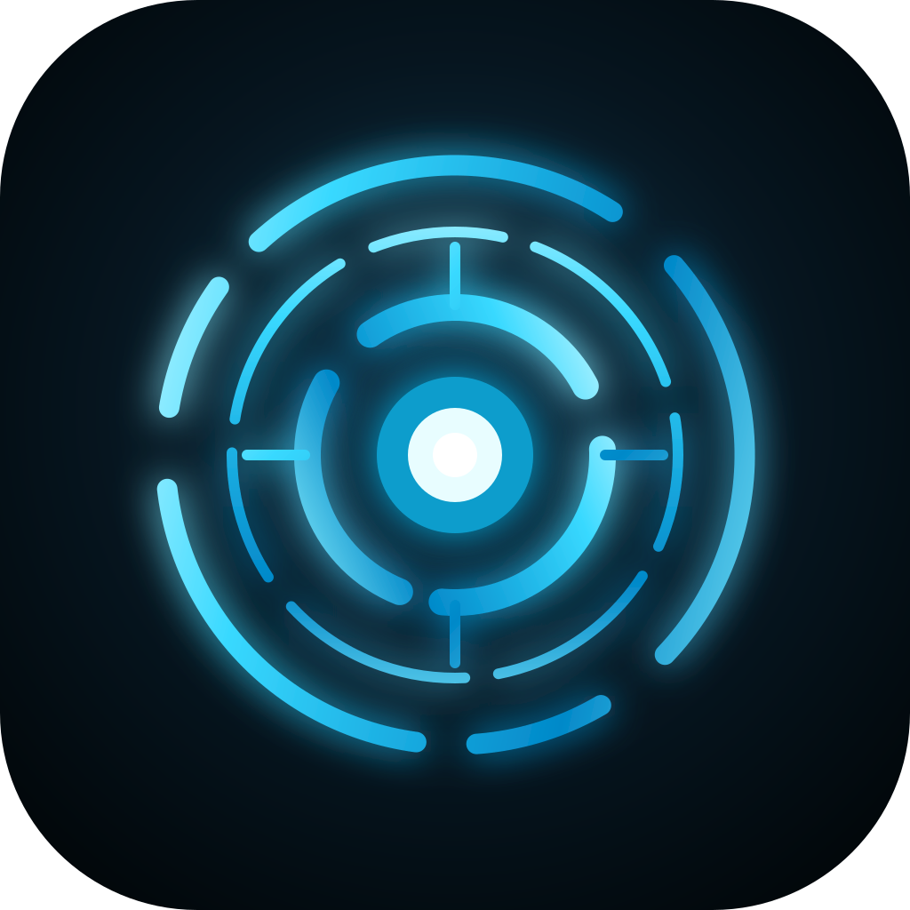
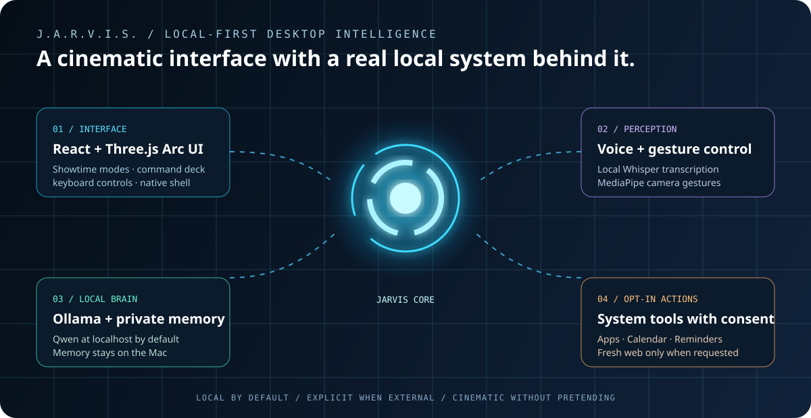
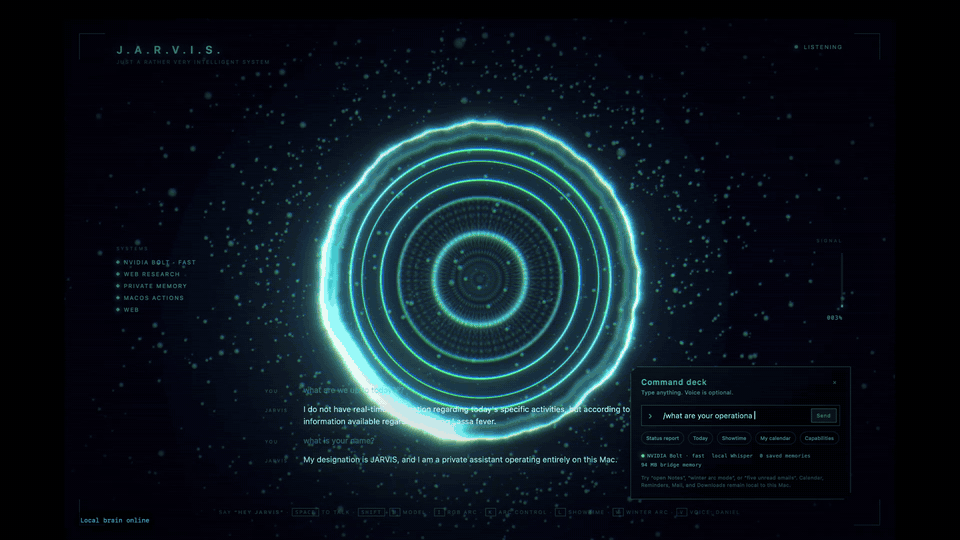
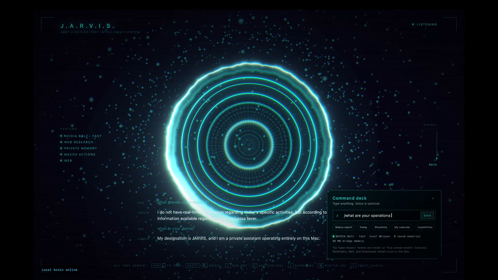
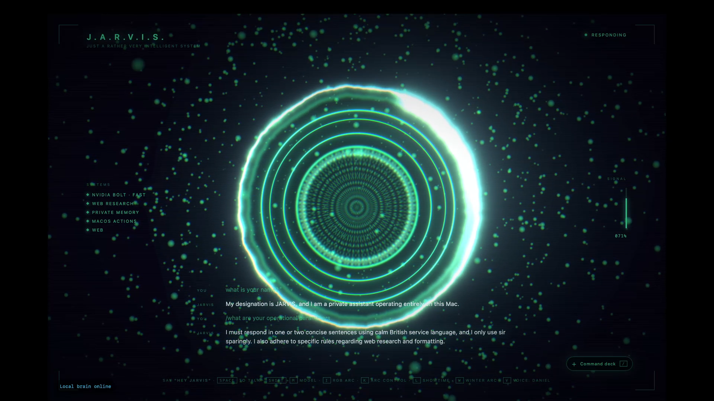
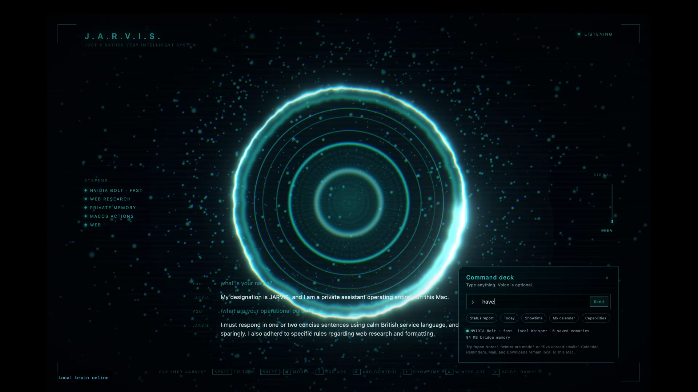
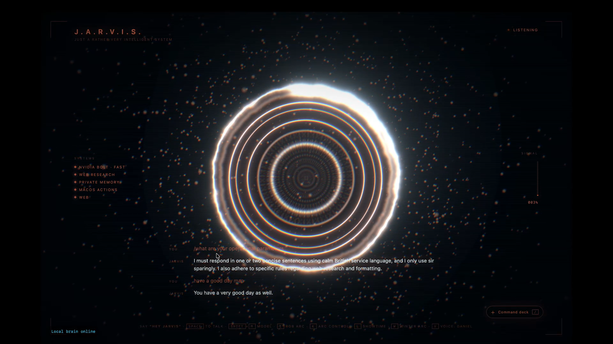

# J.A.R.V.I.S.

**A local-first, cinematic desktop assistant for macOS.**

<p align="center">
  
</p>

<p align="center">
  
</p>

JARVIS combines a reactive holographic interface with a local Qwen model, offline speech-to-text, optional local neural speech, gesture controls, private memory, and opt-in web research. It is designed to feel like a showpiece while keeping your conversations and device data on your machine by default.

## Live macOS demo

<p align="center">
  <a href="https://jahajeevan.github.io/jarvis/">
    
  </a>
</p>

<p align="center"><sub>Real macOS capture · local brain online · click the preview to watch the 1080p demo with audio.</sub></p>

### Interface states

<p align="center">
  
  
</p>
<p align="center">
  
  
</p>

For the installed macOS app, place NVIDIA settings in `~/Library/Application Support/JARVIS/.env.local`; this location is deliberately outside the app bundle and Git checkout. The app reads only `JARVIS_BRAIN`, `JARVIS_NVIDIA_API_KEY`, and `JARVIS_NVIDIA_URL` from that file.

> This is a fan-made productivity and interface project. It is not affiliated with Marvel or any of its properties.

## What it can do

- Run a local Ollama brain (default: `qwen3:8b`)
- Listen through local Whisper speech-to-text and answer with local/browser TTS
- Remember explicitly saved preferences in a private local memory store
- Fetch current headlines when a question needs fresh information
- Offer a cinematic normal Showtime and a Winter Arc presentation mode
- Drive a real-time 3D Arc interface with keyboard and camera gesture input
- Package as a native macOS `.app` and distributable DMG
- Open or quit named macOS apps with a spoken command
- Read or create Calendar events and Reminders through native macOS permission prompts
- Create a styled Mail brief from recent unread messages directly in Downloads
- Keep effectful computer actions opt-in; read-only is the default

## Architecture

```text
Microphone / Camera / Keyboard
            │
            ▼
 React + Three.js holographic UI (localhost)
            │ WebSocket
            ▼
 Local Node bridge ─────► Ollama / Qwen (127.0.0.1:11434)
       │       │
       │       ├─────────► whisper.cpp (local transcription)
       │       ├─────────► private memory.json (Application Support)
       │       └─────────► Google News RSS (only for fresh-web requests)
       ▼
 Native macOS shell (WKWebView) → JARVIS.app → DMG
```

Read the detailed design in [docs/ARCHITECTURE.md](docs/ARCHITECTURE.md).

## Quick start

### 1. Prerequisites

- macOS (Apple Silicon recommended for the native package)
- Node.js 20 or newer
- [Ollama](https://ollama.com/)

```bash
ollama pull qwen3:8b
brew install whisper-cpp ffmpeg
```

Download a Whisper GGML model with the command recommended by your `whisper-cli` installation. JARVIS discovers common local model locations.

### 2. Run from source

```bash
git clone https://github.com/adewaskar/jarvis.git
cd jarvis
npm install
npm start
```

The bridge starts in read-only mode: it cannot modify files, click/type in a browser, run shell commands, or control devices unless you deliberately enable that capability.

### 3. Build the macOS app

```bash
npm run macos:build
npm run macos:dmg
```

The app is created at `build/JARVIS.app`; the installer is placed in `build/`. The model itself is not bundled: install Ollama and pull the model first.

## Controls

| Control | Result |
| --- | --- |
| `Space` | Start / stop a voice turn |
| `K` | Enter or leave Arc Control |
| `L` | Launch the standard Showtime sequence |
| `W` | Launch the Winter Arc sequence |
| `V` | Cycle available voice modes |
| `T` | Open the typed command deck |
| `Esc` | Close panels / leave an active mode |

### Spoken controls

After the one-time initialisation click (required by macOS/web audio permission
rules), say **“Hey Jarvis”** followed by a request. These spoken controls act
instantly without waiting for the model:

- “Hey Jarvis, showtime mode”
- “Hey Jarvis, winter arc mode”
- “Hey Jarvis, arc control mode”
- “Hey Jarvis, open Notes” / “close Notes”
- “Hey Jarvis, show my calendar” / “remind me to call Mum tomorrow at 6 pm”
- “Hey Jarvis, tell me the five recent unread emails”

The Mail command writes a beautifully styled `.doc` brief to `~/Downloads`;
it does not upload mail content. Calendar, Reminders, and Mail permissions are
requested by macOS when needed.

### Arc Control

1. Show two open hands to calibrate.
2. Move hands apart or together to resize the field.
3. Move them up or down to change intensity.
4. Rotate the line between your hands to change spin.
5. Pinch one hand for an Arc pulse; hold two pinches to recalibrate.

Camera permission is required and can be managed in **System Settings → Privacy & Security → Camera**. See [docs/DEMO.md](docs/DEMO.md) for a presentation script and troubleshooting.

## Privacy and security

Local-first does not mean every feature is magically offline. The default model, memory, UI, and local speech pipeline remain on your Mac. Web research sends a query to the selected news/search service only when you ask for current information. Cloud/Claude compatibility is optional and disabled by default.

- Never commit `.env.local`, credentials, personal memory, downloaded models, the packaged app, or DMGs.
- Do not put secrets in `VITE_*` variables—those are visible in the browser.
- Keep external integrations scoped, explicit, and confirmation-gated.

Read [PRIVACY.md](PRIVACY.md) before connecting personal accounts and [SECURITY.md](SECURITY.md) before reporting a vulnerability.

## Configuration

```bash
cp .env.example .env.local
```

Useful settings include `JARVIS_BRAIN=ollama`, `JARVIS_OLLAMA_MODEL=qwen3:8b`, and `JARVIS_ALLOW_WRITES=1`. The last option authorizes potentially effectful actions; leave it unset for the safe default.

### NVIDIA fast cloud brain

To use an NVIDIA API key without exposing it to the browser, run the local bridge in NVIDIA mode:

```bash
JARVIS_BRAIN=nvidia JARVIS_NVIDIA_API_KEY=nvapi-your-key npm start
```

It starts with **Nemotron 3.5 Bolt E4B**, the low-latency voice/chat profile. Press **Shift+M** in JARVIS to toggle to **Nemotron 3.5 Lightning 30B-A3B** for harder agent tasks; press it again to return to Bolt. The active profile is shown in the SYSTEMS rail.

## Development

```bash
npm run build
npm run lint
node --check bridge/server.mjs
```

Contributions are welcome—start with [CONTRIBUTING.md](CONTRIBUTING.md).

## License

Distributed under the [MIT License](LICENSE).
